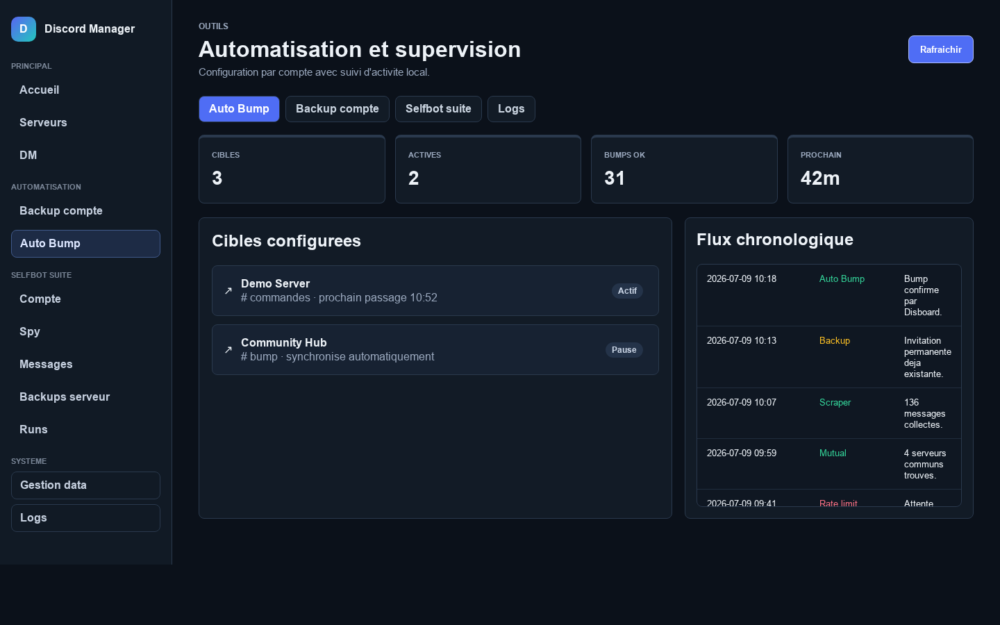
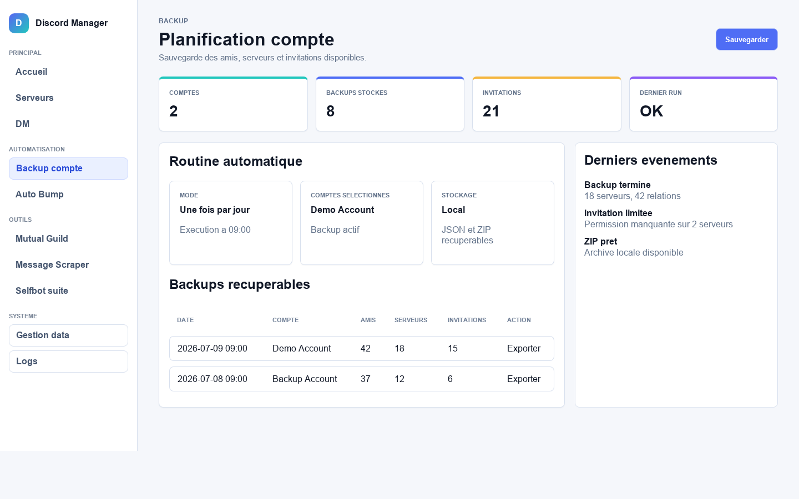

# Discord Manager Web

Interface web locale pour analyser, exporter, sauvegarder et administrer des donnees Discord depuis plusieurs comptes configures en local.

> Projet sensible a lancer uniquement sur une machine de confiance. Ne publiez jamais votre `.env`, votre base SQLite, vos exports, vos logs, vos tokens ou des captures non anonymisees.

## Apercu

### Tableau de bord


### Analyse serveur


### Conversation privee


### Outils et logs



### Backup compte



Les captures sont generees avec des donnees fictives.

## Fonctionnalites

- Gestion locale de plusieurs profils Discord.
- Analyse des serveurs au clic avec affichage des salons contenant des messages du compte.
- Analyse des conversations privees avec affichage des messages concernes.
- Recherche, pagination, selection par salon ou conversation.
- Export ZIP sans suppression pour les conversations privees.
- Export ZIP optionnel avant suppression pour serveurs et messages prives.
- Suivi des suppressions avec messages trouves, supprimes et echoues.
- Mode OPSEC pour masquer noms, IDs, avatars et champs sensibles.
- Theme clair et theme sombre persistants dans le navigateur.
- Auto Bump configurable par compte, serveur et salon.
- Backup compte avec amis, serveurs et invitations disponibles.
- Planification des backups de compte.
- Mutual Guild Finder et Message Scraper avec suivi de progression.
- Selfbot suite organisee par onglets: compte, spy, messages, backups serveur et runs.
- Gestion data pour supprimer les donnees collectees localement.
- Journal chronologique des services dans une zone scrollable.
- Scripts PM2 pour lancer, redemarrer, consulter les logs et arreter l'application.

## Securite

Cette application manipule des tokens Discord et peut effectuer des actions irreversibles.

Gardez hors Git :

- `.env`
- `discord_manager.db`
- `exports/`
- `logs/`
- `.venv/`
- fichiers JSON/ZIP de backup reels
- captures contenant des pseudos, IDs, tokens, salons ou serveurs non anonymises

Le `.gitignore` du projet exclut deja les fichiers runtime sensibles. Les tokens sont stockes en clair dans la base SQLite locale, donc la base ne doit jamais etre partagee.

## Installation

```bash
python -m venv .venv
.venv/bin/pip install -r requirements.txt
cp .env.example .env
```

Modifiez `.env` si besoin. Les valeurs par defaut lancent l'application en local sur `127.0.0.1:5000`.

## Lancement local

```bash
./run.sh
```

Puis ouvrez :

```text
http://127.0.0.1:5000
```

## Lancement PM2

Demarrer ou mettre a jour le process :

```bash
./pm2-start.sh
```

Redemarrer :

```bash
./pm2-restart.sh
```

Voir les logs :

```bash
./pm2-logs.sh
```

Voir l'etat :

```bash
pm2 status discord-manager-web
```

Arreter :

```bash
./pm2-stop.sh
```

Supprimer le process PM2 :

```bash
./pm2-delete.sh
```

## Configuration

Variables utiles :

```bash
HOST=127.0.0.1
PORT=5000
FLASK_DEBUG=0
FLASK_SECRET_KEY=change-this-local-secret
DISCORD_API_BASE_URL=https://discord.com/api/v9
DISCORD_REQUEST_TIMEOUT=10
DISCORD_MAX_RETRIES=3
DISCORD_REQUEST_SPACING=0.25
DISCORD_SEARCH_MAX_PAGES=0
DISCORD_SEARCH_INDEX_RETRIES=3
CHANNEL_MESSAGE_PAGE_SIZE=20
TASK_MESSAGE_LOG_LIMIT=1000
DM_EXPORT_MAX_PAGES=0
DM_EXPORT_ASSET_TIMEOUT=20
DM_EXPORT_MAX_ASSET_BYTES=26214400
AUTOBUMPER_ENABLED=1
ACCOUNT_BACKUP_SCHEDULER_ENABLED=1
SELFBOT_TOOLS_WORKER_ENABLED=1
```

`ecosystem.config.cjs` contient les valeurs PM2. Si vous utilisez `.env`, reportez les valeurs importantes dans la config PM2 ou exportez-les avant le lancement.

## Flux serveur

1. Ajouter un profil local.
2. Ouvrir `Serveurs`.
3. Choisir le compte puis cliquer sur un serveur.
4. L'analyse se lance automatiquement.
5. Les salons sans message du compte sont masques.
6. Ouvrir les messages d'un salon, rechercher, puis selectionner les salons utiles.
7. Supprimer avec export ZIP optionnel.

## Flux messages prives

1. Ouvrir `DM`.
2. Choisir le compte puis la conversation.
3. Verifier les messages concernes.
4. Exporter la conversation en ZIP sans suppression si besoin.
5. Supprimer avec export ZIP optionnel.

## Backups

Le backup compte collecte les informations locales utiles pour restaurer un contexte :

- relations disponibles via l'endpoint Discord;
- serveurs accessibles au compte;
- invitations permanentes existantes ou creees quand les permissions le permettent;
- resultat telechargeable en JSON ou ZIP.

La page de parametres permet de choisir les comptes a sauvegarder et la frequence d'execution.

## Donnees locales

Les resultats de scans, backups, runs et scrapes sont stockes dans `discord_manager.db`. La page `Gestion data` permet de supprimer ces donnees localement sans toucher aux messages Discord.

## Rate limits

Les appels Discord passent par un verrou global cote processus. L'application :

- espace les requetes avec `DISCORD_REQUEST_SPACING`;
- lit `X-RateLimit-Remaining` et `X-RateLimit-Reset-After` quand Discord les renvoie;
- respecte `Retry-After` et `retry_after` en cas de HTTP 429;
- limite les boucles de scan par configuration;
- conserve les resultats collectes localement pour eviter de refaire les memes requetes inutilement.

Ce mecanisme reduit le risque de rate limit, mais ne le supprime pas. Discord applique aussi des limites par route, par ressource et globales.

## Structure

```text
app.py                    Backend Flask, API Discord, SQLite, workers
templates/                Templates Jinja
static/css/app.css        Interface, themes clair/sombre
static/js/app.js          Interactions, OPSEC, theme, polling
static/favicon.svg        Favicon
docs/screenshots/         Captures anonymisees pour la documentation
requirements.txt          Dependances Python
run.sh                    Lancement local
ecosystem.config.cjs      Configuration PM2
pm2-*.sh                  Scripts PM2
```

## Limites connues

- Les tokens sont stockes en clair dans la base SQLite locale.
- Certains endpoints Discord utilises ne sont pas documentes officiellement.
- Les resultats de recherche dependent de l'index Discord et peuvent etre temporairement incomplets.
- Une tache interrompue par un redemarrage PM2 n'est pas reprise au message exact.
- L'application est concue pour un usage local, pas pour un hebergement public.
