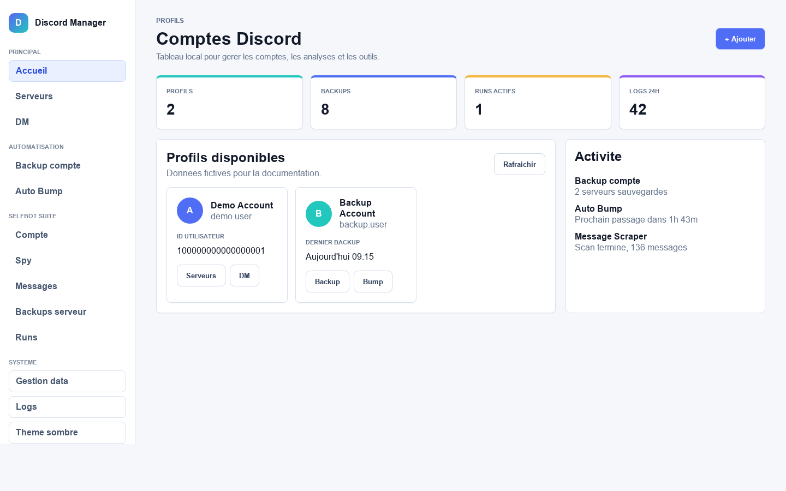
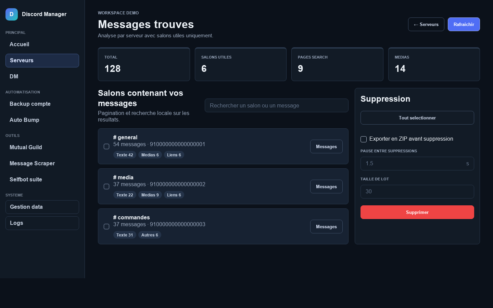
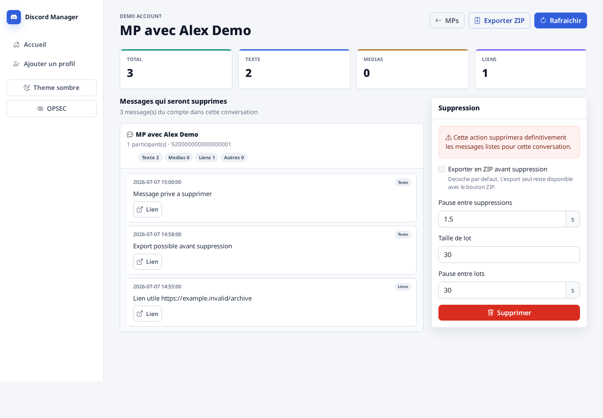

# Discord Manager Web

Interface web locale pour analyser, exporter et supprimer les messages d'un compte Discord dans les serveurs et les conversations privees.

> Outil local et sensible. Ne deploiez pas cette application sur un serveur public, ne partagez jamais votre token Discord, et verifiez toujours les salons/conversations selectionnes avant suppression.

## Apercu

### Tableau de bord



### Analyse serveur en theme sombre



### Conversation privee ciblee



## Fonctionnalites

- Gestion locale de plusieurs profils Discord.
- Liste des serveurs et conversations privees accessibles au compte.
- Analyse automatique d'un serveur au clic sur sa carte.
- Affichage uniquement des salons contenant des messages du compte.
- Recherche dans les resultats serveur.
- Messages affiches par salon ou par conversation, avec pagination.
- Suppression reelle par salon ou conversation.
- Export ZIP sans suppression pour une conversation privee.
- Export ZIP optionnel avant suppression pour serveurs et MPs.
- Page de suivi avec messages trouves, supprimes et echoues.
- Mode OPSEC pour masquer noms, IDs, avatars et champs sensibles en stream.
- Themes clair et sombre persistants dans le navigateur.
- Supervision PM2 incluse.

## Securite

Cette application manipule un token Discord et peut supprimer des messages definitivement.

Avant de publier ou partager le projet, gardez hors Git :

- `.env`
- `discord_manager.db`
- `exports/`
- `logs/`
- `.venv/`
- tout fichier contenant un token, cookie, webhook ou capture non anonymisee

Le `.gitignore` du projet exclut deja ces fichiers. Les captures presentes dans `docs/screenshots/` utilisent des donnees fictives.

## Installation

```bash
python -m venv .venv
.venv/bin/pip install -r requirements.txt
cp .env.example .env
```

Modifiez `.env` si besoin. Les valeurs par defaut lancent l'application en local sur `127.0.0.1:5000`.

## Lancement Local

```bash
./run.sh
```

Puis ouvrez :

```text
http://127.0.0.1:5000
```

## Lancement PM2

Demarrer ou mettre a jour le process :

```bash
./pm2-start.sh
```

Redemarrer :

```bash
./pm2-restart.sh
```

Voir les logs :

```bash
./pm2-logs.sh
```

Voir l'etat :

```bash
pm2 status discord-manager-web
```

Arreter :

```bash
./pm2-stop.sh
```

Supprimer le process PM2 :

```bash
./pm2-delete.sh
```

## Configuration

Variables utiles :

```bash
HOST=127.0.0.1
PORT=5000
FLASK_DEBUG=0
FLASK_SECRET_KEY=change-this-local-secret
DISCORD_API_BASE_URL=https://discord.com/api/v9
DISCORD_REQUEST_TIMEOUT=10
DISCORD_MAX_RETRIES=3
DISCORD_REQUEST_SPACING=0.25
DISCORD_SEARCH_MAX_PAGES=0
DISCORD_SEARCH_INDEX_RETRIES=3
CHANNEL_MESSAGE_PAGE_SIZE=20
TASK_MESSAGE_LOG_LIMIT=1000
DM_EXPORT_MAX_PAGES=0
DM_EXPORT_ASSET_TIMEOUT=20
DM_EXPORT_MAX_ASSET_BYTES=26214400
```

`ecosystem.config.cjs` contient les valeurs PM2. Si vous utilisez `.env`, reportez les valeurs importantes dans la config PM2 ou exportez-les avant de lancer PM2.

## Flux Serveur

1. Ajouter un profil local avec un token Discord.
2. Cliquer sur `Serveurs`.
3. Cliquer sur un serveur.
4. L'analyse se lance automatiquement via l'endpoint Discord search.
5. L'interface affiche uniquement les salons contenant des messages du compte.
6. Ouvrir les messages d'un salon, rechercher, selectionner les salons utiles.
7. Supprimer, avec export ZIP optionnel avant suppression.

## Flux Messages Prives

1. Cliquer sur `MPs`.
2. Cliquer sur une conversation.
3. Voir uniquement les messages du compte qui seront concernes.
4. Exporter la conversation en ZIP sans suppression si besoin.
5. Supprimer la conversation selectionnee, avec export ZIP optionnel avant suppression.

## Exports ZIP

Les ZIP contiennent :

- `transcript.html` : lecture hors ligne.
- `messages.json` : messages bruts retournes par Discord.
- `metadata.json` : resume de l'export.
- `avatars/`, `attachments/`, `embeds/` : assets telecharges quand possible.

## Rate Limits

Les appels Discord passent par un verrou global cote processus. L'application :

- espace les requetes avec `DISCORD_REQUEST_SPACING`;
- lit `X-RateLimit-Remaining` et `X-RateLimit-Reset-After` quand Discord les renvoie;
- respecte `Retry-After` / `retry_after` en cas de HTTP 429;
- utilise une recherche globale par serveur pour eviter une recherche salon par salon.

Ce mecanisme reduit le risque de rate limit, mais ne le supprime pas. Discord applique aussi des limites par route, par ressource et globales.

## Structure

```text
app.py                    Backend Flask, API Discord, SQLite, workers
templates/                Templates Jinja
static/css/app.css        Interface, themes clair/sombre
static/js/app.js          Interactions, OPSEC, theme, polling
static/favicon.svg        Favicon
docs/screenshots/         Captures anonymisees pour la documentation
requirements.txt          Dependances Python
run.sh                    Lancement local
ecosystem.config.cjs      Configuration PM2
pm2-*.sh                  Scripts PM2
```

## Limites Connues

- Les tokens sont stockes en clair dans la base SQLite locale.
- L'application utilise des endpoints Discord non officiels pour la recherche de messages.
- Une tache interrompue par un redemarrage PM2 est marquee comme interrompue; elle n'est pas reprise au message exact.
- Les resultats dependent de l'index de recherche Discord, qui peut etre temporairement incomplet.
- L'application est concue pour un usage local, pas pour un hebergement public.
# discord-manager-web
